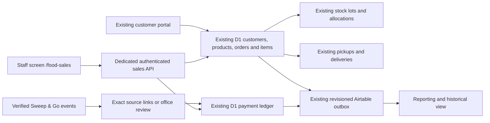

# Unified Extreme Dog Fuel sales — local implementation and release review

Prepared November 4, 2026. **Login-only rollout configuration.** New native sale recording stays disabled until usable stock, lot numbers and expiration dates are verified. The owner separately approved the new schema and catalog-plus-tax policy. The original historical migration archive remains unchanged; new DDL is verified separately by `data/production-schema-changes.json`. Live release/account status is reported in the handoff. No charge, historical sales import, recurring-billing change or customer message is part of this rollout.

## Audit and baseline

The original working tree was clean on `main`, commit `7d03acfd39e3e16ca287251d5a92b520937e7450`. Remote `main`, checked with `git ls-remote`, matched. Work is on `codex/unified-food-sales`; changes are uncommitted. Command-scoped `safe.directory` was needed because Windows reports a different owner SID; no global Git trust setting was changed.

The production public `/api/release-status/` returned `6d0392e2-354f-4a86-a823-1ae5d610dc7b`, matching the local release metadata. This confirms the release identifier, **not** deployed database schema, private runtime flags, provider credentials, or operational data. Read-only `wrangler deployments list --json` was attempted and failed because this session has no Cloudflare API credentials. Live Airtable/SNG payloads and complete historical exports were not available through this checkout. No live customer, stock or billing records were inferred from fixtures.

Read `AGENTS.md`, `README.md`, `PRIVATE_BUILD_INPUTS.md`, CI, private migration verification, current schemas/test templates, food sales workspace, operations store, checkout/portal, payment services, lots/fulfillment triggers, Airtable outbox, SNG processor/webhook security, staff authentication, middleware, and existing tests. Original production migration bytes still verify. No historical templates or production SQL files were modified.

The prior review is accurate for this source revision:

| Finding | Verified source behavior |
|---|---|
| Manual sale | `foodOperation(save_sale)` writes one Airtable sale; opening collected amount is distinct from later receipts. Requires owner admin access. |
| Website checkout | Verified customer account/profile creates native orders/items/lot reservations, then Stripe checkout; D1 changes project to Airtable by stable IDs. |
| Airtable dependencies | Shared stock checkpoints, exact formula/weight mappings, legacy customers/sales, inventory adjustments, reporting and collections still depend on it. |
| Food authorization | Admin food APIs use `verifyAdminRequest`; separate field/office identities exist but had no food-sales grant. |
| Existing SNG reconciliation | Verified accepted payment + unique recent all-food invoice + unique same-customer/same-total open order. This is a narrow heuristic, not a full food-sale import. |

Additional constraints found during audit: one captured-payment index per order; payment/proof prerequisites on pickups and deliveries; required unique customer email and required order address; `posting_enabled` controls both reporting projection and online readiness. These required explicit changes for multiple receipts, unpaid staff handoffs, minimum customer entry, and independent reporting. No materially different branch or source baseline was found. Private deployed configuration and schema were subsequently inspected through authenticated Cloudflare access. The reviewed schema change was applied after separate approval; historical order, payment, customer and lot counts were unchanged. Operational snapshots and the recovery backup remain in ignored private storage.

## Shared records and ownership



New orders use `source=staff_sales`. Order metadata separately records the signed-in member, pricing policy and intended billing provider (`manual` or `sweep_and_go`). Payments separately record actual method, amount, reference, receipt date and source evidence. Pickup/delivery records determine fulfillment. None of these fields substitutes for another.

| Data | Owner during pilot |
|---|---|
| New staff sale/customer links, item prices, totals, receipts, refunds, handoff evidence | D1. Airtable is a projection; native lines and receipts cannot be independently changed through legacy commands. Customer imports cannot overwrite staff-linked native customers. |
| Historical Airtable-only sales/receipts/customers | Existing source retained pending reviewed migration. No automatic merging by customer name, date or amount. |
| Product prices | Existing native catalog. Staff quotes use the same rounding/tax helper as the portal, only after a separate policy approval. No price/tax override accepted from the browser. |
| Physical counts and current stock | Existing Airtable checkpoint + native sold/returned movements and verified D1 lots. Both must reconcile before a new staff allocation. |
| Existing SNG billing/recurring plans | Sweep & Go remains the billing owner. This implementation creates no subscriptions or parallel Stripe recurring billing. |

The new `projection_enabled` pilot setting allows reporting without enabling live online checkout. Existing online `posting_enabled`, `scheduling_enabled`, live-key, profile, delivery coverage and consent gates remain. Staff sales cannot be charged through the customer checkout endpoint or directly through `createDogFoodCheckout`.

## Permissions and sessions

The owner confirms the individual email before any provisioning. Recommended account: an individual existing-system member with base role `viewer`, active only in `org-opwp`, plus a separately approved `dog_food_sales_grants` row. A technician can also receive an explicit grant if their existing field access is intended; food access does not grant field access.

| Action | Food-sales staff | Owner MFA |
|---|---|---|
| Search shared food customers, add minimum shared customer data, quote catalog | Yes | Existing owner tools |
| Save native sale / actual receipt / actual handoff | Yes; writes attributed to member ID | Reviewed native tools |
| Recent staff entries / append receipts / correction requests | Own staff orders only | Review queue |
| Edit settled amounts, destructive deletion, refund or usable return | No | Audited record-only endpoints; refund records require evidence of money already returned |
| Exact SNG invoice or existing-payment links, review outcomes | No | `/admin/dog-food/review/` |
| Payroll, unrelated finance, purchasing, credentials, integrations, account management | No food permission | Existing authorization remains |

Uses existing staff identity records with separate food-sales password credentials. Passwords use the existing workerd-compatible scrypt implementation and require at least fifteen characters, including a capital and symbol. A one-time, twenty-four-hour setup link lets the individual choose their own password; only the token hash is retained. Existing field PIN credentials are unchanged. The new cookie/session namespace is separate from field, office, owner and customer sessions. It is HttpOnly, SameSite Strict, Secure on HTTPS; tokens are random and stored as hashes. Absolute expiry is eight hours; inactivity expiry is thirty minutes. Every data request joins active member, organization, grant revision and password version. Grant revocation, revision changes, deactivation and password reset invalidate sessions. Failed password attempts increment atomically; five failures lock for fifteen minutes. Login has IP and account quotas; authenticated APIs have per-member fail-closed quotas, strict same-origin writes and bounded bodies. Owner MFA code is unchanged.

The screen retains a draft and exact pending payload in session storage, scoped by member ID. Only the unresolved submission ID/rejection marker survives tab closure in local storage. Pending PII is not retained in local storage. Logout revokes the server session and clears the draft. A tab closed during uncertainty can still check its saved ID; if no payload remains, office reconciliation is required before starting another sale. These are device-local drafts, not an offline sale queue.

## Reliability, receipts and inventory

`food-sales-ledger.mjs` extends native records instead of invoking customer checkout. A D1 batch atomically commits the customer/address if needed, order/items, receipt/evidence, lot allocations, pickup/delivery, handoff evidence, audit and completed submission result. D1's [batch contract](https://developers.cloudflare.com/d1/worker-api/d1-database/#batch) rolls back the sequence when a statement fails. Unique submission IDs bind actor and canonical payload hash: identical retries return the original result; changed content or another actor is rejected. A lease guard inside the batch rejects a stale worker. Existing portal commands retain their own persistent IDs.

Staff, portal, office stock operations and SNG reconciliation share the existing operation lease. Database lot constraints provide an additional defense against stale reservation plans. An atomic receipt-balance trigger prevents concurrent overpayment. Noncash provider references have unique idempotency keys; cash uses a persistent receipt identity. Historic unit prices stay on order items. A method alone, delivery, an invoice, or a subscription never creates payment evidence.

Existing unexpired/confirmed lot selection and quarantine rules remain. Staff handoff attestation is a separate immutable source of evidence; ordinary online/driver deliveries still need their existing payment/private-photo workflow. Staff pickups/deliveries can complete with an unpaid balance. They consume allocated stock once. UTC completion evidence is stored with a server-derived Eastern local date for expiry validation. New staff transactional messages are suppressed.

An office **recorded actual refund** retains gross amount and refunded amount separately and credits that returned money against the staff balance; it does not create a fresh debt or change historical tax/price fields. This is not a Stripe refund operation. A separately confirmed usable, unexpired physical return against the original consumed lot adds stock exactly once and records a native inventory movement. Damaged/quarantined/expired returns cannot be added as usable bags through this path. Staff cannot invoke either office action. Broader price corrections stay in office review; no arbitrary settled-record rewrite is supplied.

## Sweep & Go evidence and limits

The repository example shows `invoice_id`, `client`, `items`, invoice `total`, and accepted-payment `reference_number`/`amount`. Its accepted-payment example has **no invoice ID**. Stable line/job/payment IDs beyond those fields have not been verified in production. Tests that include payment `invoice_id` are synthetic capability tests, not evidence that the live provider supplies it.

Existing SNG billing and reconciliation stay active unless the separately approved `FOOD_SALES_SNG_RECONCILIATION_ENABLED` adapter flag is enabled. Legacy heuristic reconciliation permanently excludes new `staff_sales` orders. With both native sales and the separate SNG adapter active, verified food financial events are archived and handled by the conservative adapter; unverified recoveries cannot acquire financial authority. Invoice-only events cannot mark an order paid. SNG reconciliation also remains separately disabled by `sng_enabled` until payload review.

An auto-applied receipt requires an archived verified payment, stable reference, exact client ID, invoice reference, compatible all-food invoice versions, and an office-approved exact invoice/order link. A matching existing manual reference attaches evidence instead of adding money. Missing invoice references, mixed invoices, conflicting versions, equal-value unmatched orders, possible manual receipt overlap and overpayments remain in review. Out-of-order archived payments are rechecked after invoice/link arrival or an office retry. Office can attach an otherwise ambiguous verified payment to a specifically reviewed existing receipt without increasing money collected.

No broad SNG invoice-to-new-sale importer is enabled. Unlinked sales and mixed allocations require reviewed source mapping; review resolution does not silently manufacture a sale, payment or stock movement. Establish actual SNG payload coverage and line/product mappings before expanding automatic ingestion.

## Historical dry run

Run only against private exports or the committed fabricated example:

```powershell
node scripts/food-sales-dry-run.mjs --input tests/fixtures/food-sales-migration.json --output docs/food-sales/synthetic-dry-run.json
node scripts/food-sales-dry-run.mjs --input private/food-sales/export.json --output private/food-sales/dry-run.json
```

There is no apply mode, provider client or database writer in the planner. Operational outputs are restricted to private storage. The JSON fixture specifies the versioned normalization contract: complete native customers/products/orders/items/payments/lots/subscriptions/movements; Airtable customers/products/sales/receipts/plans/stock; SNG customers/invoices/payments/plans; explicit reviewed mappings; source coverage and export timestamp. Retain raw exports privately alongside the normalized input and verify exporter completeness before asserting coverage.

The repeatable synthetic output contains exact identity maps, original amounts/dates/source IDs, proposed historical records, duplicate evidence links, unresolved exceptions, before/after counts and balances, lots/reservations, recurring plans and rollback requirements:

| Synthetic result | Before | Proposed after |
|---|---:|---:|
| Native orders | 1 | 2 |
| Historical sales total | $63.57 | $183.57 |
| Received | $30.00 | $90.00 |
| Balance | $33.57 | $93.57 |
| Current stock changes from history | 0 | 0 |

Two duplicates remain evidence only: one Airtable projection and one SNG copy of a manual payment. Three exceptions remain: an unlinked SNG payment, a mixed invoice, and recurring-plan overlap. The stock/lot example reconciles at eight usable bags and one reserved bag. SNG recurring billing is preserved. `productionReady=false` is intentional. **A private dry run of the deployed native ledger, current Airtable snapshot and archived SNG evidence was subsequently produced. It proposes no historical imports: paid labels lack receipt amounts, sale/customer links need review and provider-wide SNG coverage is unverified. No current stock movement or historical data migration was applied.** Original production exports, live schema/configuration and rollback backups must be available first. Source tombstones are proposed, not applied; an executable historical migrator is deferred until reviewed production mappings are approved.

## Validation and known gaps

See [VALIDATION.md](VALIDATION.md) for final command results and exact verification limits. Tests use isolated SQLite databases rendered from test templates plus the new proposed schema; production SQL is never used as fabricated test data. A loopback harness runs the real React component, route handlers, PIN verification and ledger against disposable data, with external provider and rate-limit transports isolated. The HTTP demonstration covers a response lost **after commit**, status recovery, replay, final receipt and session revocation.

Mobile CSS uses responsive single-column cards, sixteen-pixel inputs and at least forty-four-pixel controls. Chrome accessibility inspection verified synthetic login and the authenticated form. The browser host was unavailable and native screenshot capture returned another application, including after rebinding the Chrome window. Those images are excluded. No trustworthy mobile screenshots were obtained; no Safari/iPhone or Android device test is claimed. Before pilot acceptance, complete a real phone flow in Safari and Chrome, including background/resume, keyboard, refresh, unstable network and orientation, and capture the requested screenshots.

## Decisions and staged release

1. Obtain read-only Cloudflare/Airtable/SNG evidence: deployed schema/migration version, runtime flags, provider field mappings, raw payment/invoice/event examples, source completeness and backups. Review differences before choosing migrations. Public release-ID matching is insufficient.
2. Confirm Tony's individual email/identity, intended base role and final food-sales permissions. No shared owner login. Decide whether the initial staff policy should use current website catalog plus 7.75% tax, as the proposed gated policy does. Historical manual totals have no enforced equivalent tax policy. Confirm refund/credit workflow and office review ownership. Do not enable staff writes until these decisions are approved.
3. Review `schema-proposals/0060_unified_food_sales.sql` against the actual deployed private archive, index names, triggers and existing data. Separately authorize a real schema migration and backup/restore rehearsal. Do not copy generated test migrations into production. The archive verifier retains the original sixty files and separately verifies the exact reviewed source/hash of the new migration. It also rejects undeclared extra SQL.
4. Lock new-sale entry and managed-field editing in Airtable; retain historical editing only through reviewed ownership rules. Retain old history and exact customer/product references. Keep `FOOD_SALES_LEGACY_WRITES_FROZEN=true` after the first pilot activation. Evaluate legacy collections/sync jobs and establish durable migration tombstones before any historical import.
5. Run CI/security/build gates, review all changes and separately authorize the guarded website deployment. Only use `npm run deploy -- --summary "..."` after gates pass. No database migration is bundled with that command. Initially leave native sales, SNG reconciliation and online readiness disabled.
6. After approved schema, pricing, phone acceptance and identity setup, separately activate the pilot runtime flag and approved sales settings/grant. Reporting can use `projection_enabled` with online checkout still disabled. Inspect one real approved pilot sale, receipts, outbox read-back and stock before widening access. No real account is created by the application or preview script.
7. Review actual historical dry run and all exceptions; then design/review/approve repeatable apply and rollback with source tombstones. Independently approve any historical production-data mutation. Independently approve enabling verified SNG reconciliation. Keep SNG plans/billing unchanged.
8. Existing/future portal orders share customer, order, receipt and inventory records. Actual live checkout, new charges and customer messages retain their separate readiness/approval steps; synthetic tests do not authorize activation.

Rollback before any new production records can restore a verified pre-release snapshot and compatible prior code after stopping writers. After new records exist, prefer disabling the native sales/grants/SNG flags while retaining this compatible reader, schema and Airtable outbox; freeze legacy writers, preserve commands/evidence and reconcile in-flight saves. Do not blindly revert to code that cannot see staff orders or recreate the old single-capture index over multiple receipts. After live activity, use reviewed compensating financial/physical records rather than deleting sale history or restoring a stale database. SNG billing remains running under its existing owner throughout.

## Login-only activation

`FOOD_SALES_NATIVE_ENABLED=true` exposes individual password login and food workspace reads. `FOOD_SALES_RECORDING_ENABLED=false` blocks new native saves on the server and in the screen. Existing office Airtable sales continue during this stage; enabling native recording automatically freezes that legacy new-sale writer. `FOOD_SALES_SNG_RECONCILIATION_ENABLED=false` keeps current SNG handling in place. Existing online scheduling, billing, owner MFA and customer-notification readiness gates remain unchanged.

The owner-only `/admin/dog-food/staff-access/` page reviews an exact email and scoped permissions, issues a one-time setup/reset link, and revokes access. It cannot silently reuse a manager/owner or inactive/ambiguous identity. Food sessions cannot administer staff accounts. Setup links and passwords are not written into audit or command payloads, emailed automatically, or committed to source.
